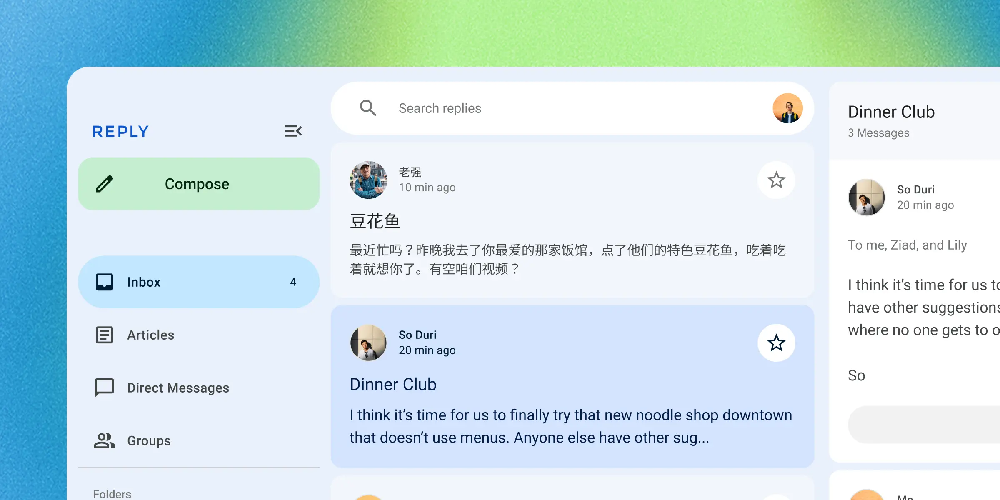

## What is Material?

Material Design is a design system built and supported by Google designers and
developers. Guidelines for building Material apps and components are published
on [material.io](https://material.io).

Version 3.0 implements **Material 3 Expressive**, the latest evolution of
Material 3: a larger shape scale with shape morphing, spring-based motion, an
emphasized type scale, and an updated dynamic color system. The elements are
named `md-gb-*`, follow the
[WAI-ARIA](https://www.w3.org/TR/wai-aria-1.3/) patterns for
their roles, and only rely on web platform features that are
[Baseline](https://web.dev/baseline) widely available (newer
features are guarded and degrade gracefully).



## What are web components?

[Web components](https://developer.mozilla.org/en-US/docs/Web/API/Web_components)
are custom HTML elements with encapsulated styles and behavior. They work across
many different frameworks (such as Lit, React, Vue, and Svelte) as well as web
environments (such as Eleventy, Wordpress, and Ruby on Rails).

Many components in this library are drop-in replacements for browser elements
like `<button>` and `<input>`. Every element is prefixed with `md-gb-`.

```html
<form>
  <md-gb-text-field label="Email" type="email" name="email" required></md-gb-text-field>
  <label>
    Subscribe
    <md-gb-checkbox name="subscribe"></md-gb-checkbox>
  </label>

  <md-gb-button type="reset" variant="text">Reset</md-gb-button>
  <md-gb-button>Submit</md-gb-button>
</form>
```

## What are tokens?

[Design tokens](https://m3.material.io/foundations/design-tokens/overview)
are the building blocks of all UI elements. In MWC, tokens are
[CSS custom properties](https://developer.mozilla.org/en-US/docs/Web/CSS/--*)
that can be used to style components. Version 3.0 provides the system tokens
for color, typography, shape, elevation, and motion.

```css
:root {
  --md-sys-color-primary: olive;
  --md-sys-color-secondary: tomato;
  --md-ref-typeface-brand: 'Open Sans';
  --md-ref-typeface-plain: system-ui;
}
```
