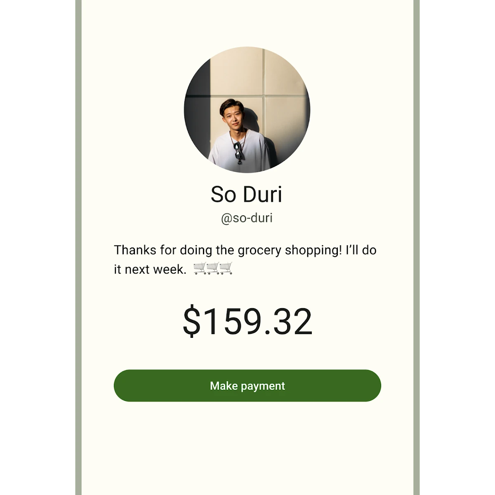

There are five types of common buttons: elevated, filled, filled tonal,
outlined, and text.



*   [Design article](https://m3.material.io/components/buttons)
*   [API Documentation](#api)
*   [Source code](https://github.com/material-components/material-web/tree/main/button)

## Interactive Demo



## Types

<div class="figure-wrapper">
  <figure class="types-image" style="justify-content:center;" title="Elevated, filled, filled tonal, outlined, and text buttons" aria-label="The 5 types of common buttons">
    <style>
      .types-image .wrapper,
      .types-image .wrapper > * {
        display: flex;
        padding: 8px;
        flex-wrap: wrap;
        justify-content: center;
      }
      .types-image .wrapper > * {
        flex-direction: column;
        align-items: center;
        padding-inline: 16px;
      }
      .types-image span {
        display: inline-flex;
        background-color: var(--md-sys-color-inverse-surface);
        color: var(--md-sys-color-inverse-on-surface);
        padding: 8px;
        margin-block-start: 8px;
        width: 24px;
        height: 24px;
        border-radius: 50%;
        justify-content: center;
        align-items: center;
      }
    </style>
    <div class="wrapper">
      <div>
        <md-gb-button color="elevated"><md-gb-icon>add</md-gb-icon>
          Elevated
        </md-gb-button>
        <span>1</span>
      </div>
      <div>
        <md-gb-button color="filled">Filled</md-gb-button>
        <span>2</span>
      </div>
      <div>
        <md-gb-button color="tonal">Tonal</md-gb-button>
        <span>3</span>
      </div>
      <div>
        <md-gb-button color="outlined">Outlined</md-gb-button>
        <span>4</span>
      </div>
      <div>
        <md-gb-button color="text">Text</md-gb-button>
        <span>5</span>
      </div>
    </div>
  </figure>
</div>

1.  [Elevated button](#elevated-button)
1.  [Filled button](#filled-button)
1.  [Filled tonal button](#filled-tonal-button)
1.  [Outlined button](#outlined-button)
1.  [Text button](#text-button)

## Usage

Buttons have label text that describes the action that will occur if a user taps
a button.

<div class="figure-wrapper">
  <figure style="justify-content:center;gap: 8px;" title="Outlined and filled buttons." aria-label="An outlined button with the text 'Back' next to a filled button with the text 'Complete'">
    <md-gb-button color="outlined">Back</md-gb-button>
    <md-gb-button color="filled">Complete</md-gb-button>
  </figure>
</div>

```html
<md-gb-button color="outlined">Back</md-gb-button>
<md-gb-button color="filled">Complete</md-gb-button>
```

### Icon

An icon may optionally be added to a button to help communicate the button's
action and help draw attention.

<div class="figure-wrapper">
  <figure style="justify-content:center;gap: 8px;" title="Outlined and filled buttons." aria-label="An outlined button with the text 'Back' next to a filled button with the text 'Complete'">
    <md-gb-button color="tonal"><md-gb-icon><svg viewBox="0 0 48 48"><path d="M6 40V8l38 16Zm3-4.65L36.2 24 9 12.5v8.4L21.1 24 9 27Zm0 0V12.5 27Z"></path></svg></md-gb-icon>
      Send
    </md-gb-button>
    <md-gb-button color="text">
      Open
    <md-gb-icon><svg viewBox="0 0 48 48"><path d="M9 42q-1.2 0-2.1-.9Q6 40.2 6 39V9q0-1.2.9-2.1Q7.8 6 9 6h13.95v3H9v30h30V25.05h3V39q0 1.2-.9 2.1-.9.9-2.1.9Zm10.1-10.95L17 28.9 36.9 9H25.95V6H42v16.05h-3v-10.9Z"></path></svg></md-gb-icon></md-gb-button>
  </figure>
</div>

```html
<md-gb-button color="tonal"><md-gb-icon><svg viewBox="0 0 48 48"><path d="M6 40V8l38 16Zm3-4.65L36.2 24 9 12.5v8.4L21.1 24 9 27Zm0 0V12.5 27Z"></path></svg></md-gb-icon>
  Send

</md-gb-button>

<md-gb-button color="text">
  Open

<md-gb-icon><svg viewBox="0 0 48 48"><path d="M9 42q-1.2 0-2.1-.9Q6 40.2 6 39V9q0-1.2.9-2.1Q7.8 6 9 6h13.95v3H9v30h30V25.05h3V39q0 1.2-.9 2.1-.9.9-2.1.9Zm10.1-10.95L17 28.9 36.9 9H25.95V6H42v16.05h-3v-10.9Z"></path></svg></md-gb-icon></md-gb-button>
```

## Accessibility

Add an
[`aria-label`](https://developer.mozilla.org/en-US/docs/Web/Accessibility/ARIA/Attributes/aria-label)
attribute to buttons whose labels need a more descriptive label.

```html
<md-gb-button aria-label="Add a new contact" color="elevated">Add</md-gb-button>
```

### Focusable and disabled

By default, disabled buttons are not focusable with the keyboard, while
"soft-disabled" buttons are. Some use cases encourage focusability of disabled
toolbar items to increase their discoverability.

See the
[ARIA guidelines on focusability of disabled controls](https://www.w3.org/WAI/ARIA/apg/practices/keyboard-interface/#kbd_disabled_controls)
for guidance on when this is recommended.

```html
<div role="toolbar">
  <md-gb-button color="text">Copy</md-gb-button>
  <md-gb-button color="text">Cut</md-gb-button>
  <!--
    This button is disabled but kept focusable to improve its discoverability
    in the toolbar.
  -->
  <md-gb-button soft-disabled color="text">Paste</md-gb-button>
</div>
```

## Elevated button

[Elevated buttons](https://m3.material.io/components/buttons/guidelines#4e89da4d-a8fa-4e20-bb8d-b8a93eff3e3e)
are essentially filled tonal buttons with a shadow. To prevent shadow creep,
only use them when absolutely necessary, such as when the button requires visual
separation from a patterned background.

<div class="figure-wrapper">
  <figure style="justify-content:center;align-items:center;" aria-label="An elevated button.">
    <md-gb-button color="elevated">Elevated</md-gb-button>
  </figure>
</div>

```html
<md-gb-button color="elevated">Elevated</md-gb-button>
```

## Filled button

[Filled buttons](https://m3.material.io/components/buttons/guidelines#9ecffdb3-ef29-47e7-8d5d-f78b404fcafe)
have the most visual impact after the FAB, and should be used for important,
final actions that complete a flow, like Save, Join now, or Confirm.

<div class="figure-wrapper">
  <figure style="justify-content:center;align-items:center;" aria-label="A filled button.">
    <md-gb-button color="filled">Filled</md-gb-button>
  </figure>
</div>

```html
<md-gb-button color="filled">Filled</md-gb-button>
```

## Filled tonal button

A
[filled tonal button](https://m3.material.io/components/buttons/guidelines#07a1577b-aaf5-4824-a698-03526421058b)
is an alternative middle ground between filled and outlined buttons. They're
useful in contexts where a lower-priority button requires slightly more emphasis
than an outline would give, such as "Next" in an onboarding flow.

<div class="figure-wrapper">
  <figure style="justify-content:center;align-items:center;" aria-label="A tonal button.">
    <md-gb-button color="tonal">Tonal</md-gb-button>
  </figure>
</div>

```html
<md-gb-button color="tonal">Tonal</md-gb-button>
```

## Outlined button

[Outlined buttons](https://m3.material.io/components/buttons/guidelines#3742b09f-c224-43e0-a83e-541bd29d0f05)
are medium-emphasis buttons. They contain actions that are important, but aren’t
the primary action in an app.

<div class="figure-wrapper">
  <figure style="justify-content:center;align-items:center;" aria-label="An outlined button.">
    <md-gb-button color="outlined">Outlined</md-gb-button>
  </figure>
</div>

```html
<md-gb-button color="outlined">Outlined</md-gb-button>
```

## Text button

[Text buttons](https://m3.material.io/components/buttons/guidelines#c9bcbc0b-ee05-45ad-8e80-e814ae919fbb)
are used for the lowest priority actions, especially when presenting multiple
options.

<div class="figure-wrapper">
  <figure style="justify-content:center;align-items:center;" aria-label="A text button.">
    <md-gb-button color="text">Text</md-gb-button>
  </figure>
</div>

```html
<md-gb-button color="text">Text</md-gb-button>
```

## API


