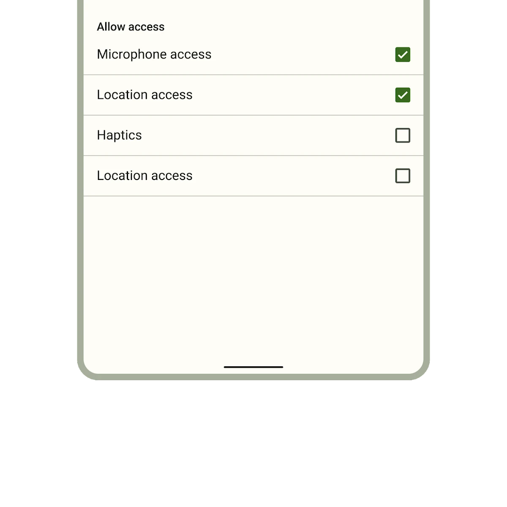

[Checkboxes](https://m3.material.io/components/checkbox) allow users
to select one or more items from a set. Checkboxes can turn an option on or off.

There's one type of checkbox in Material. Use this selection control when the
user needs to select one or more options from a list.



*   [Design article](https://m3.material.io/components/checkbox)
*   [API Documentation](#api)
*   [Source code](https://github.com/material-components/material-web/tree/main/checkbox)

## Interactive Demo



## Usage

Checkboxes may be standalone, pre-checked, or indeterminate.

<div class="figure-wrapper">
  <figure style="justify-content:center;" aria-label="Three checkboxes in a row that are unselected, selected, and indeterminate">
    <md-gb-checkbox></md-gb-checkbox>
    <md-gb-checkbox checked></md-gb-checkbox>
    <md-gb-checkbox indeterminate></md-gb-checkbox>
  </figure>
</div>

```html
<md-gb-checkbox></md-gb-checkbox>
<md-gb-checkbox checked></md-gb-checkbox>
<md-gb-checkbox indeterminate></md-gb-checkbox>
```

### Label

Associate a label with a checkbox using the `<label>` element.

<div class="figure-wrapper">
  <figure style="justify-content: center; align-items: center" aria-label="Two checkboxes with labels">
    <label style="display: flex; align-items: center">
      <md-gb-checkbox></md-gb-checkbox>
      Checkbox one
    </label>
    <md-gb-checkbox id="checkbox-two"></md-gb-checkbox>
    <label for="checkbox-two">Checkbox two</label>
  </figure>
</div>

```html
<label>
  <md-gb-checkbox></md-gb-checkbox>
  Checkbox one
</label>

<md-gb-checkbox id="checkbox-two"></md-gb-checkbox>
<label for="checkbox-two">Checkbox two</label>
```

## Accessibility

Add an
[`aria-label`](https://developer.mozilla.org/en-US/docs/Web/Accessibility/ARIA/Attributes/aria-label)
attribute to checkboxes without labels or checkboxes whose labels need to be
more descriptive.

```html
<md-gb-checkbox aria-label="Select all checkboxes"></md-gb-checkbox>

<label>
  <md-gb-checkbox aria-label="Agree to terms and conditions"></md-gb-checkbox>
  Agree
</label>
```

> Note: checkboxes are not automatically labelled by `<label>` elements and
> always need an `aria-label`. See b/294081528.

## API


