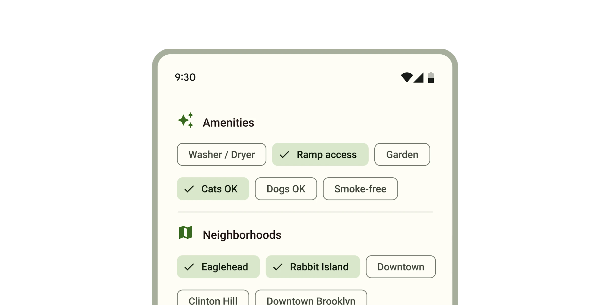

While buttons are expected to appear consistently and with familiar calls to
action, chips should appear dynamically as a group of multiple interactive
elements.



*   [Design article](https://m3.material.io/components/chips)
*   [API Documentation](#api)
*   [Source code](https://github.com/material-components/material-web/tree/main/chips)

## Types

1.  [Assist chip](#assist-chip)
1.  [Filter chip](#filter-chip)
1.  [Input chip](#input-chip)
1.  [Suggestion chip](#suggestion-chip)

## Interactive Demo



## Usage

Choose the type of chip based on its purpose and author.

-   **Assist** chips are common actions, such as adding an event to a calendar.
-   **Filter** chips are tags used to filter content, such as shopping
    categories.
-   **Input** chips are pieces of information entered by a user, such as event
    attendees.
-   **Suggestion** chips represent dynamic suggestions for user input, such as
    text message replies.

```html
<md-gb-chip-set>
  <md-gb-chip type="action" color="outlined">Assist</md-gb-chip>
  <md-gb-chip type="filter" color="outlined">Filter</md-gb-chip>
  <md-gb-chip type="action" color="outlined" removable>Input</md-gb-chip>
  <md-gb-chip type="action" color="outlined">Suggestion</md-gb-chip>
</md-gb-chip-set>
```

### Chip sets

Chips should always appear in a set. Chip sets are
[toolbars](https://developer.mozilla.org/en-US/docs/Web/Accessibility/ARIA/Roles/toolbar_role)
that can display any type of chip or other toolbar items.

```html
<h3>New event</h3>
<md-gb-chip-set>
  <md-gb-chip type="filter" color="outlined">All day</md-gb-chip>
  <md-gb-chip type="action" color="outlined">Add to calendar</md-gb-chip>
  <md-gb-chip type="action" color="outlined">Set a reminder</md-gb-chip>
</md-gb-chip-set>
```

### Icons

All chips may display an optional icon. Input chips can specify if an avatar
picture is displayed.

<!-- Need to add catalog-include "figures/<component>/usage-scenario-one.html"

```html
<md-gb-chip-set>
  <md-gb-chip type="action" color="outlined">
    <md-gb-icon slot="icon">event</md-gb-icon>
  Add to calendar</md-gb-chip>

  <md-gb-chip type="action" color="outlined" removable>
    
  Ping Qiang</md-gb-chip>
</md-gb-chip-set>
```

### Elevated

Assist, filter, and suggestion chips can be elevated if the placement requires
protection, such as on top of an image.

<!-- Need to add catalog-include "figures/<component>/usage-scenario-one.html"

```html
<div>
  
  <md-gb-chip-set>
    <md-gb-chip type="action" color="elevated">Share</md-gb-chip>
    <md-gb-chip type="action" color="elevated">Favorite</md-gb-chip>
  </md-gb-chip-set>
</div>
```

## Accessibility

Add an
[`aria-label`](https://developer.mozilla.org/en-US/docs/Web/Accessibility/ARIA/Attributes/aria-label)
attribute to chip sets or reference a label with
[`aria-labelledby`](https://developer.mozilla.org/en-US/docs/Web/Accessibility/ARIA/Attributes/aria-labelledby).
Add an `aria-label` to chips whose labels need to be more descriptive.

```html
<h3 id="dates-label">Dates</h3>
<md-gb-chip-set aria-labelledby="dates-label">
  <md-gb-chip aria-label="Monday" type="filter" color="outlined">Mon</md-gb-chip>
  <md-gb-chip aria-label="Tuesday" type="filter" color="outlined">Tue</md-gb-chip>
  <md-gb-chip aria-label="Wednesday" type="filter" color="outlined">Wed</md-gb-chip>
</md-gb-chip-set>
```

### Focusable and disabled

By default, disabled chips are not focusable with the keyboard, while
"soft-disabled" chips are. Some use cases encourage focusability of disabled
toolbar items to increase their discoverability.

See the
[ARIA guidelines on focusability of disabled controls](https://www.w3.org/WAI/ARIA/apg/practices/keyboard-interface/#kbd_disabled_controls)
for guidance on when this is recommended.

```html
<md-gb-chip-set aria-label="Actions">
  <!--
    Disabled until text is selected. Since both are disabled by default, keep
    them focusable so that screen readers can discover the actions available.
  -->
  <md-gb-chip soft-disabled type="action" color="outlined">Copy</md-gb-chip>
  <md-gb-chip soft-disabled type="action" color="outlined">Paste</md-gb-chip>
</md-gb-chip-set>
<md-gb-text-field type="textarea" variant="outlined"></md-gb-text-field>
```

## Assist chip

[Assist chips](https://m3.material.io/components/chips/guidelines#5dd1928c-1476-4029-bdc5-fde66fc0dcb1)
represent smart or automated actions that can span multiple apps, such as
opening a calendar event from the home screen.

Assist chips function as though the user asked an assistant to complete the
action. They should appear dynamically and contextually in a UI.

<!-- Need to add catalog-include "figures/<component>/usage-scenario-one.html"

```html
<h3>A restaraunt location</h3>
<md-gb-chip-set>
  <md-gb-chip type="action" color="outlined">
    <md-gb-icon slot="icon">calendar</md-gb-icon>
  Add to my itinerary</md-gb-chip>
  <md-gb-chip type="action" color="outlined">
    <md-gb-icon slot="icon">map</md-gb-icon>
  12 mins from hotel</md-gb-chip>
</md-gb-chip-set>
```

## Filter chip

[Filter chips](https://m3.material.io/components/chips/guidelines#8d453d50-8d8e-43aa-9ae3-87ed134d2e64)
use tags or descriptive words to filter content. They can be a good alternative
to toggle buttons or checkboxes.

<!-- Need to add catalog-include "figures/<component>/usage-scenario-one.html"

```html
<h3>Choose where to share</h3>
<md-gb-chip-set>
  <md-gb-chip type="filter" color="outlined">Docs</md-gb-chip>
  <md-gb-chip selected type="filter" color="outlined">Slides</md-gb-chip>
  <md-gb-chip selected type="filter" color="outlined">Sheets</md-gb-chip>
  <md-gb-chip type="filter" color="outlined">Images</md-gb-chip>
</md-gb-chip-set>
```

### Removable

Filter chips can optionally be removable from the chip set. Removable chips have
a trailing remove icon.

<!-- Need to add catalog-include "figures/<component>/usage-scenario-one.html"

```html
<h3>Colors</h3>
<md-gb-chip-set>
  <md-gb-chip removable selected type="filter" color="outlined">Red</md-gb-chip>
  <md-gb-chip removable type="filter" color="outlined">Yellow</md-gb-chip>
  <md-gb-chip removable type="filter" color="outlined">Blue</md-gb-chip>
  <md-gb-chip removable type="filter" color="outlined">Green</md-gb-chip>
</md-gb-chip-set>
```

## Input chip

[Input chips](https://m3.material.io/components/chips/guidelines#4d2d5ef5-3fcd-46e9-99f2-067747b2393f)
represent discrete pieces of information entered by a user, such as Gmail
contacts or filter options within a search field.

Input chips whose icons are user images may add the `avatar` attribute to
display the image in a larger circle.

<!-- Need to add catalog-include "figures/<component>/usage-scenario-one.html"

```html
<md-gb-text-field label="Attendees" type="email" variant="outlined"></md-gb-text-field>

<md-gb-chip-set>
  <md-gb-chip type="action" color="outlined" removable>
    
  Ping Qiang</md-gb-chip>
  <md-gb-chip type="action" color="outlined" removable>
    
  Thea Schröder</md-gb-chip>
</md-gb-chip-set>
```

### Remove-only

All input chips are removable. If an input chip does not have an action
associated with clicking on it, it may be marked as `remove-only`.

<!-- Need to add catalog-include "figures/<component>/usage-scenario-one.html"

```html
<h3>Favorite movies</h3>
<md-gb-chip-set>
  <md-gb-chip type="action" color="outlined" removable>Star Wars</md-gb-chip>
  <md-gb-chip type="action" color="outlined" removable>Star Trek</md-gb-chip>
</md-gb-chip-set>
```

## Suggestion chip

[Suggestion chips](https://m3.material.io/components/chips/guidelines#36d7bb16-a9bf-4cf6-a73d-8e05510d66a7)
help narrow a user’s intent by presenting dynamically generated suggestions,
such as possible responses or search filters.

<!-- Need to add catalog-include "figures/<component>/usage-scenario-one.html"

```html
<h3>Suggested reply</h3>
<md-gb-chip-set>
  <md-gb-chip type="action" color="outlined">I agree</md-gb-chip>
  <md-gb-chip type="action" color="outlined">Looks good to me</md-gb-chip>
  <md-gb-chip type="action" color="outlined">Thank you</md-gb-chip>
</md-gb-chip-set>
```

## API


