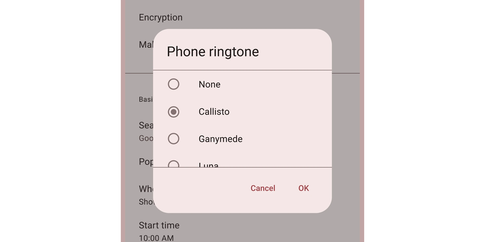

*   [Design article](https://m3.material.io/components/dialogs)
*   [API Documentation](#api)
*   [Source code](https://github.com/material-components/material-web/tree/main/dialog)

## Interactive Demo



## Usage

Dialogs behave like
[`<dialog>`](https://developer.mozilla.org/en-US/docs/Web/API/HTMLDialogElement)
elements, and can be closed with a `<form method="dialog">` element.

Dialogs have three optional sections: the headline title, the main content, and
action buttons.

```html
<md-gb-dialog>
  <div slot="headline">
    Dialog title
  </div>
  <form id="form-id" method="dialog">
    A simple dialog with free-form content.
  </form>
  <div slot="actions">
    <md-gb-button form="form-id" color="text">Ok</md-gb-button>
  </div>
</md-gb-dialog>
```

> Tip: use `margin`, `height`, and `width` CSS properties to control the
> dialog's size and position.

### Opening and closing

Dialogs are opened and closed by setting the `open` attribute or property.

```html
<md-gb-dialog open>
  <div>
    A dialog that is opened by default.
  </div>
</md-gb-dialog>
```

Dialogs are also opened and closed by calling `dialog.show()` and
`dialog.close()`.

Both return a Promise that resolves after the dialog's animation finishes.

```ts
closeButton.addEventListener('click', async () => {
  await dialog.close();
});
```

### Return value

A button's value attribute will set the dialog's `returnValue` property to
identify which button closed it.

```html
<md-gb-dialog open>
  <form id="form-id" method="dialog">...</form>
  <div slot="actions">
    <md-gb-button form="form-id" value="cancel" color="text">Cancel</md-gb-button>
    <md-gb-button form="form-id" value="ok" color="text">Ok</md-gb-button>
  </div>
</md-gb-dialog>
```

```ts
dialog.addEventListener('close', () => {
  const cancelClicked = dialog.returnValue === 'cancel';
  const okClicked = dialog.returnValue === 'ok';
});
```

## Accessibility

Dialogs are labelled by their headlines. Add an
[`aria-label`](https://developer.mozilla.org/en-US/docs/Web/Accessibility/ARIA/Attributes/aria-label)
attribute to dialogs without a headline.

```html
<md-gb-dialog aria-label="Error message">
  <div>An error occurred, details ...</div>
</md-gb-dialog>
```

### Alerts

Add a
[`type="alert"`](https://developer.mozilla.org/en-US/docs/Web/Accessibility/ARIA/Roles/alertdialog_role)
attribute to dialogs that need to communicate an important message and require a
user's response.

Common examples include error messages that require confirmation and other
action confirmation prompts.

```html
<md-gb-dialog type="alert">
  <div slot="headline">Confirm deletion</div>
  <form id="form-id" method="dialog">
    Are you sure you wish to delete this item?
  </form>
  <div slot="actions">
    <md-gb-button form="form-id" value="cancel" color="text">Cancel</md-gb-button>
    <md-gb-button form="form-id" value="delete" color="text">Delete</md-gb-button>
  </div>
</md-gb-dialog>
```

## API


