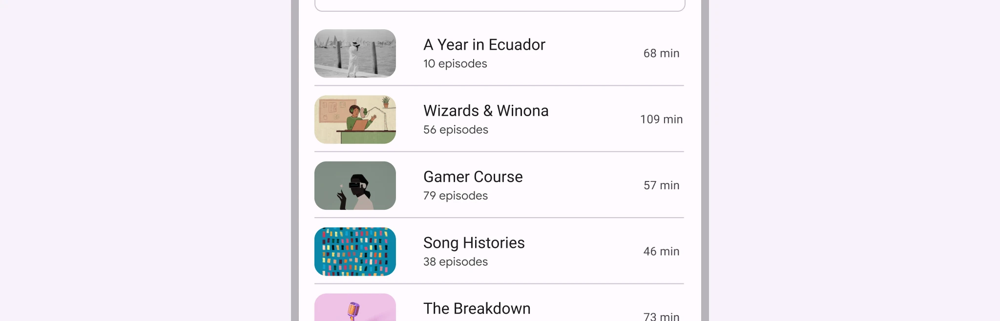

Dividers can reinforce tapability, such as when used to separate list items or
define tappable regions in an accordion.



*   [Design article](https://m3.material.io/components/divider)
*   [API Documentation](#api)
*   [Source code](https://github.com/material-components/material-web/tree/main/labs/gb/components/divider)

## Interactive Demo



## Usage

Use full width dividers to separate larger sections of unrelated content.

```js
import '@material/web/labs/gb/components/divider/md-gb-divider.js';
```

```html
<section>
  <p>Lorem ipsum...</p>
  <md-gb-divider></md-gb-divider>
  <p>Lorem ipsum...</p>
</section>
```

### Class API

For plain HTML, the `divider()` class API styles a native `<hr>`. Add
`vertical: true` for a vertical divider.



### Inset dividers

Use inset dividers to separate related content within a section. `inset`
indents both ends by 16dp (the spec's middle-inset divider); `inset-start`
indents the leading end (the inset divider) and `inset-end` the trailing end.



## Accessibility

Dividers are decorative by default and not announced by assistive technology.

Add a
[`role="separator"`](https://developer.mozilla.org/en-US/docs/Web/Accessibility/ARIA/Roles/separator_role)
attribute to non-decorative dividers that should be announced.

```html
<ul>
  <li>Item one</li>
  <md-gb-divider inset></md-gb-divider>
  <li>Item two</li>
  <md-gb-divider role="separator"></md-gb-divider>
  <li>Item three</li>
</ul>
```

## Theming

Divider supports [theming](/3.0/styles/color/) and can be customized with its
CSS custom properties.

| Property | Default value |
| --- | --- |
| `--color` | `--md-sys-color-outline-variant` |
| `--thickness` | `1px` |
| `--inset-leading-space` | `--md-sys-space-200` (16dp) |
| `--inset-trailing-space` | `--md-sys-space-200` (16dp) |

```html
<style>
md-gb-divider {
  --color: #bec9c8;
  --thickness: 2px;
}
</style>

<section>
  <p>Lorem ipsum...</p>
  <md-gb-divider></md-gb-divider>
  <p>Lorem ipsum...</p>
</section>
```

## API


