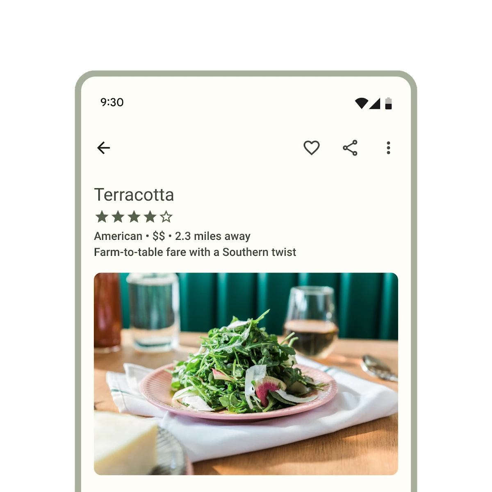

**This documentation is fully rendered on the
[Material Web catalog](https://material-web.dev/components/icon-button/).**

[Icon buttons](https://m3.material.io/components/icon-buttons) help
people take supplementary actions with a single tap.



*   [Design article](https://m3.material.io/components/icon-buttons)
*   [API Documentation](#api)
*   [Source code](https://github.com/material-components/material-web/tree/main/iconbutton)

## Interactive Demo



## Types

<div class="figure-wrapper">
  <figure class="types-image" style="justify-content:center;" title="1 - Standard Icon Button. 2 - Contained Icon Button (including filled, filled tonal, and outlined styles)" aria-label="Side by side view of standard and contained icon buttons">
    <style>
      .types-image .wrapper,
      .types-image .wrapper > * {
        display: flex;
        padding: 8px;
        flex-wrap: wrap;
        justify-content: center;
      }
      .types-image .wrapper > * {
        flex-direction: column;
        align-items: center;
        padding-inline: 16px;
      }
      .types-image span {
        display: inline-flex;
        background-color: var(--md-sys-color-inverse-surface);
        color: var(--md-sys-color-inverse-on-surface);
        padding: 8px;
        margin-block-start: 8px;
        width: 24px;
        height: 24px;
        border-radius: 50%;
        justify-content: center;
        align-items: center;
      }
      .types-image .wrapper > div > div {
        display: flex;
        gap: 8px;
      }
    </style>
    <div class="wrapper">
      <div>
        <div>
          <md-gb-icon-button color="standard" aria-label="Favorite">
            <md-gb-icon>favorite</md-gb-icon>
          </md-gb-icon-button>
          <md-gb-icon-button selected color="standard" aria-label="Bookmark">
            <md-gb-icon class="filled">bookmark</md-gb-icon>
          </md-gb-icon-button>
        </div>
        <span>1</span>
      </div>
      <div>
        <div>
          <md-gb-icon-button color="filled" aria-label="Video call">
            <md-gb-icon>videocam</md-gb-icon>
          </md-gb-icon-button>
          <md-gb-icon-button color="tonal" aria-label="Settings">
            <md-gb-icon>settings</md-gb-icon>
          </md-gb-icon-button>
          <md-gb-icon-button color="outlined" aria-label="More options">
            <md-gb-icon>more_vert</md-gb-icon>
          </md-gb-icon-button>
        </div>
        <span>2</span>
      </div>
    </div>
  </figure>
</div>

1.  [Icon Button](#icon-button)
2.  [Filled Icon Button](#filled-icon-button)
3.  [Filled Tonal Icon Button](#filled-tonal-icon-button)
4.  [Outlined Icon Button](#outlined-icon-button)

## Usage

Use icon buttons to display actions in a compact layout. Icon buttons can
represent opening actions such as opening an overflow menu or search, or
represent binary actions that can be toggled on and off, such as favorite or
bookmark.

Icon buttons can be grouped together or they can stand alone.

To use icons by name, see the [Icon](icon.md#usage) documentation for loading
the icon font.

<div class="figure-wrapper">
  <figure style="justify-content:center;gap: 8px;" title="Icon buttons can be used within other components, such as a bottom app bar" aria-label="A row of icon buttons">
    <md-gb-icon-button color="standard" aria-label="Check">
      <md-gb-icon>check</md-gb-icon>
    </md-gb-icon-button>
    <md-gb-icon-button color="filled" aria-label="Check">
      <md-gb-icon>check</md-gb-icon>
    </md-gb-icon-button>
    <md-gb-icon-button color="tonal" aria-label="Check">
      <md-gb-icon>check</md-gb-icon>
    </md-gb-icon-button>
    <md-gb-icon-button color="outlined" aria-label="Check">
      <md-gb-icon>check</md-gb-icon>
    </md-gb-icon-button>
  </figure>
</div>

```html
<md-gb-icon-button color="standard" aria-label="Check">
  <md-gb-icon>check</md-gb-icon>
</md-gb-icon-button>
<md-gb-icon-button color="filled" aria-label="Check">
  <md-gb-icon>check</md-gb-icon>
</md-gb-icon-button>
<md-gb-icon-button color="tonal" aria-label="Check">
  <md-gb-icon>check</md-gb-icon>
</md-gb-icon-button>
<md-gb-icon-button color="outlined" aria-label="Check">
  <md-gb-icon>check</md-gb-icon>
</md-gb-icon-button>
```

### Links

Add an
[`href`](https://developer.mozilla.org/en-US/docs/Web/HTML/Element/a#href)
and optionally a
[`target`](https://developer.mozilla.org/en-US/docs/Web/HTML/Element/a#target)
attribute to turn the icon button into a link.

```html
<md-gb-icon-button href="https://google.com" color="standard" aria-label="Check">
  <md-gb-icon>check</md-gb-icon>
</md-gb-icon-button>
```

### Toggle

<div class="figure-wrapper">
  <figure style="gap:8px;flex-direction:column;padding-block:8px;" aria-label="Two rows of toggling icon buttons, the top row is unselected and the bottom row is selected">
    <div style="display:flex;gap:8px;">
      <md-gb-icon-button color="standard" aria-label="Close">
        <md-gb-icon>close</md-gb-icon>
      </md-gb-icon-button>
      <md-gb-icon-button color="filled" aria-label="Close">
        <md-gb-icon>close</md-gb-icon>
      </md-gb-icon-button>
      <md-gb-icon-button color="tonal" aria-label="Close">
        <md-gb-icon>close</md-gb-icon>
      </md-gb-icon-button>
      <md-gb-icon-button color="outlined" aria-label="Close">
        <md-gb-icon>close</md-gb-icon>
      </md-gb-icon-button>
    </div>
    <div style="display:flex;gap:8px;">
      <md-gb-icon-button selected color="standard" aria-label="Close">
        <md-gb-icon>close</md-gb-icon>
      </md-gb-icon-button>
      <md-gb-icon-button selected color="filled" aria-label="Close">
        <md-gb-icon>close</md-gb-icon>
      </md-gb-icon-button>
      <md-gb-icon-button selected color="tonal" aria-label="Close">
        <md-gb-icon>close</md-gb-icon>
      </md-gb-icon-button>
      <md-gb-icon-button selected color="outlined" aria-label="Close">
        <md-gb-icon>close</md-gb-icon>
      </md-gb-icon-button>
    </div>
  </figure>
</div>

Toggle icon buttons allow a single choice to be selected or deselected, such as
adding or removing something from favorites.

Add a second icon in the `slot="selected"` slot to change the icon when
selected. Toggle icon buttons can be pre-selected by adding the `selected`
attribute.

```html
<div>
  <md-gb-icon-button color="standard" aria-label="Close">
    <md-gb-icon>close</md-gb-icon>

  </md-gb-icon-button>
  <md-gb-icon-button color="filled" aria-label="Close">
    <md-gb-icon>close</md-gb-icon>

  </md-gb-icon-button>
  <md-gb-icon-button color="tonal" aria-label="Close">
    <md-gb-icon>close</md-gb-icon>

  </md-gb-icon-button>
  <md-gb-icon-button color="outlined" aria-label="Close">
    <md-gb-icon>close</md-gb-icon>

  </md-gb-icon-button>
</div>
<div>
  <md-gb-icon-button selected color="standard" aria-label="Close">
    <md-gb-icon>close</md-gb-icon>

  </md-gb-icon-button>
  <md-gb-icon-button selected color="filled" aria-label="Close">
    <md-gb-icon>close</md-gb-icon>

  </md-gb-icon-button>
  <md-gb-icon-button selected color="tonal" aria-label="Close">
    <md-gb-icon>close</md-gb-icon>

  </md-gb-icon-button>
  <md-gb-icon-button selected color="outlined" aria-label="Close">
    <md-gb-icon>close</md-gb-icon>

  </md-gb-icon-button>
</div>
```

## Accessibility

Add an
[`aria-label`](https://developer.mozilla.org/en-US/docs/Web/Accessibility/ARIA/Attributes/aria-label)
attribute to icon buttons whose labels need a more descriptive label.

```html
<md-gb-icon-button aria-label="Search for Contact" color="standard">
  <md-gb-icon>search</md-gb-icon>
</md-gb-icon-button>
```

### Toggle

Add an `aria-label-selected` attribute to toggle buttons whose labels need a
more descriptive label when selected.

```html
<md-gb-icon-button aria-label="Unselected" aria-label-selected="Selected" color="standard">
  <md-gb-icon>close</md-gb-icon>

</md-gb-icon-button>
```

### Focusable and disabled

By default, disabled icon buttons are not focusable with the keyboard, while
"soft-disabled" icon buttons are. Some use cases encourage focusability of
disabled toolbar items to increase their discoverability.

See the
[ARIA guidelines on focusability of disabled controls](https://www.w3.org/WAI/ARIA/apg/practices/keyboard-interface/#kbd_disabled_controls)
for guidance on when this is recommended.

```html
<div role="toolbar">
  <md-gb-icon-button aria-label="Copy" color="standard">
    <md-gb-icon>copy</md-gb-icon>
  </md-gb-icon-button>
  <md-gb-icon-button aria-label="Cut" color="standard">
    <md-gb-icon>cut</md-gb-icon>
  </md-gb-icon-button>
  <!--
    This icon button is disabled but kept focusable to improve its
    discoverability in the toolbar.
  -->
  <md-gb-icon-button aria-label="Paste" soft-disabled color="standard">
    <md-gb-icon>paste</md-gb-icon>
  </md-gb-icon-button>
</div>
```

## Icon Button

Standard icon buttons do not have a background or outline, and have the lowest
emphasis of the icon buttons.

<div class="figure-wrapper">
  <figure style="justify-content:center;gap: 8px;" title="Standard Icon Button with Check icon" aria-label="A check icon">
    <md-gb-icon-button color="standard" aria-label="Check">
      <md-gb-icon>check</md-gb-icon>
    </md-gb-icon-button>
  </figure>
</div>

```html
<md-gb-icon-button color="standard" aria-label="Check">
  <md-gb-icon>check</md-gb-icon>
</md-gb-icon-button>
```

## Filled Icon Button

<div class="figure-wrapper">
  <figure style="justify-content:center;gap: 8px;" title="Filled Icon Button" aria-label="A circular button with a check icon">
    <md-gb-icon-button color="filled" aria-label="Check">
      <md-gb-icon>check</md-gb-icon>
    </md-gb-icon-button>
  </figure>
</div>

Filled icon buttons have higher visual impact and are best for high emphasis
actions.

```html
<md-gb-icon-button color="filled" aria-label="Check">
  <md-gb-icon>check</md-gb-icon>
</md-gb-icon-button>
```

## Filled Tonal Icon Button

<div class="figure-wrapper">
  <figure style="justify-content:center;gap: 8px;" title="Filled Tonal Icon Button" aria-label="A filled tonal icon button with a check icon">
    <md-gb-icon-button color="tonal" aria-label="Check">
      <md-gb-icon>check</md-gb-icon>
    </md-gb-icon-button>
  </figure>
</div>

Filled tonal icon buttons are a middle ground between filled and outlined icon
buttons. They're useful in contexts where the button requires slightly more
emphasis than an outline would give, such as a secondary action paired with a
high emphasis action.

```html
<md-gb-icon-button color="tonal" aria-label="Check">
  <md-gb-icon>check</md-gb-icon>
</md-gb-icon-button>
```

## Outlined Icon Button

<div class="figure-wrapper">
  <figure style="justify-content:center;gap: 8px;" title="Outlined Icon button" aria-label="An outlined circular icon button with a check icon">
    <md-gb-icon-button color="outlined" aria-label="Check">
      <md-gb-icon>check</md-gb-icon>
    </md-gb-icon-button>
  </figure>
</div>

Outlined icon buttons are medium-emphasis buttons. They're useful when an icon
button needs more emphasis than a standard icon button but less than a filled or
filled tonal icon button.

```html
<md-gb-icon-button color="outlined" aria-label="Check">
  <md-gb-icon>check</md-gb-icon>
</md-gb-icon-button>
```

## API


