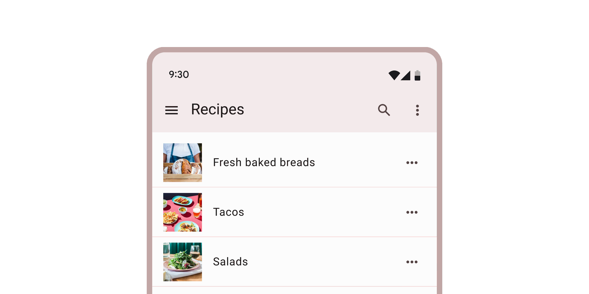

*   [Design article](https://m3.material.io/components/lists)
*   [API Documentation](#api)
*   [Source code](https://github.com/material-components/material-web/tree/main/list)

## Interactive Demo



## Usage

`<md-gb-list>` is a container composed of `<md-gb-list-item>`s of different types.

<div class="figure-wrapper">
  <figure aria-label="Three items in a list. The first item says Apple as its headline. The second one says Banana in its headline as well as Banana is a yellow fruit as its sub header. The third list item says Cucumber in its headline and Cucumbers are long green fruits that are just as long as this multi-line description as its sub header which is on two lines.">
  <md-gb-list style="max-width: 300px;">
    <md-gb-list-item>
      Fruits
    </md-gb-list-item>
    <md-gb-divider></md-gb-divider>
    <md-gb-list-item>
      Apple
    </md-gb-list-item>
    <md-gb-list-item>
      Banana
    </md-gb-list-item>
    <md-gb-list-item>
      Cucumber
      <div slot="supporting-text">Cucumbers are long green fruits that are just as long as this multi-line description</div>
    </md-gb-list-item>
    <md-gb-list-item interactive href="https://google.com/search?q=buy+kiwis&amp;tbm=shop" target="_blank">
      Shop for Kiwis
      <div slot="supporting-text">This will link you out in a new tab</div>
      <md-gb-icon slot="trailing">open_in_new</md-gb-icon>
    </md-gb-list-item>
  </md-gb-list>
  </figure>
</div>

```html
<md-gb-list style="max-width: 300px;">
  <md-gb-list-item>
    Fruits
  </md-gb-list-item>
  <md-gb-divider></md-gb-divider>
  <md-gb-list-item>
    Apple
</md-gb-list-item>
  <md-gb-list-item>
    Banana
  </md-gb-list-item>
  <md-gb-list-item>
    Cucumber
    <div slot="supporting-text">Cucumbers are long green fruits that are just as long as this multi-line description</div>
  </md-gb-list-item>
  <md-gb-list-item type="link" href="https://google.com/search?q=buy+kiwis&amp;tbm=shop" target="_blank">
    Shop for Kiwis
    <div slot="supporting-text">This will link you out in a new tab</div>
    <md-gb-icon slot="trailing">open_in_new</md-gb-icon>
  </md-gb-list-item>
</md-gb-list>
```

## Icon Items

Icons can be slotted into list-items' `start` or `end` slot.

<div class="figure-wrapper">
  <figure aria-label="A list with three items and dividers separating each item. The first item has the Lit logo and the text Lit. The second item has the Polymer logo and the text Polymer. The third item has the Angular logo and the text Angular.">
    <md-gb-list style="max-width: 300px">
      <md-gb-list-item>
        Lit
        <svg slot="leading" style="height: 24px" viewBox="0 0 160 200">
          <path fill="currentColor" d="m160 80v80l-40-40zm-40 40v80l40-40zm0-80v80l-40-40zm-40 40v80l40-40zm-40-40v80l40-40zm40-40v80l-40-40zm-40 120v80l-40-40zm-40-40v80l40-40z"></path>
        </svg>
      </md-gb-list-item>
      <md-gb-divider></md-gb-divider>
      <md-gb-list-item>
        Polymer
        <md-gb-icon slot="leading">polymer</md-gb-icon>
      </md-gb-list-item>
      <md-gb-divider></md-gb-divider>
      <md-gb-list-item>
        Angular
        <svg slot="leading" style="height: 24px" viewBox="0 0 250 250">
          <polygon points="108,135.4 125,135.4 125,135.4 125,135.4 142,135.4 125,94.5 	"></polygon>
          <path d="M125,30L125,30L125,30L31.9,63.2l14.2,123.1L125,230l0,0l0,0l78.9-43.7l14.2-123.1L125,30z M183.1,182.6h-21.7h0
              l-11.7-29.2H125h0h0h-24.7l-11.7,29.2h0H66.9h0L125,52.1l0,0l0,0l0,0l0,0L183.1,182.6L183.1,182.6z"></path>
        </svg>
      </md-gb-list-item>
    </md-gb-list>
  </figure>
</div>

```html
<md-gb-list style="max-width: 300px">
  <md-gb-list-item>
    Lit
    <svg slot="leading" style="height: 24px" viewBox="0 0 160 200">
      <path fill="currentColor" d="m160 80v80l-40-40zm-40 40v80l40-40zm0-80v80l-40-40zm-40 40v80l40-40zm-40-40v80l40-40zm40-40v80l-40-40zm-40 120v80l-40-40zm-40-40v80l40-40z"></path>
    </svg>
  </md-gb-list-item>
  <md-gb-divider></md-gb-divider>
  <md-gb-list-item>
    Polymer
    <md-gb-icon slot="leading">polymer</md-gb-icon>
  </md-gb-list-item>
  <md-gb-divider></md-gb-divider>
  <md-gb-list-item>
    Angular
    <svg slot="leading" style="height: 24px" viewBox="0 0 250 250">
      <polygon points="108,135.4 125,135.4 125,135.4 125,135.4 142,135.4 125,94.5   "></polygon>
      <path d="M125,30L125,30L125,30L31.9,63.2l14.2,123.1L125,230l0,0l0,0l78.9-43.7l14.2-123.1L125,30z M183.1,182.6h-21.7h0
          l-11.7-29.2H125h0h0h-24.7l-11.7,29.2h0H66.9h0L125,52.1l0,0l0,0l0,0l0,0L183.1,182.6L183.1,182.6z"></path>
    </svg>
  </md-gb-list-item>
</md-gb-list>
```

## Image Items

Images should be slotted into list-items' `start` slot.

<div class="figure-wrapper">
  <figure aria-label="A list with three image items. The first item is a square picture of a cat and the text Cat. The second is a picture of a kitten with the text Kitty Cat. The third item is a square image of an older kitten with the text Cate.">
    <md-gb-list style="max-width: 300px">
      <md-gb-list-item>
        Cat
        
      </md-gb-list-item>
      <md-gb-divider></md-gb-divider>
      <md-gb-list-item>
        Kitty Cat
        
      </md-gb-list-item>
      <md-gb-divider></md-gb-divider>
      <md-gb-list-item>
        Cate
        
      </md-gb-list-item>
    </md-gb-list>
  </figure>
</div>

```html
<md-gb-list style="max-width: 300px;">
  <md-gb-list-item>
    Cat
    
  </md-gb-list-item>
  <md-gb-divider></md-gb-divider>
  <md-gb-list-item>
    Kitty Cat
    
  </md-gb-list-item>
  <md-gb-divider></md-gb-divider>
  <md-gb-list-item>
    Cate
    
  </md-gb-list-item>
</md-gb-list>
```

## Accessibility

List can have its `role` and `tabindex` set via the `role` and `tabindex`
attributes, and list items can have their `role` and `tabindex` set via the
`type` and `tabindex` attributes respectively.

> NOTE: List item has a limited set of `type`s that can be set on it. This is to
> ensure that your list remains accessible with all other properties and options
> presented to it. See the `ListItemType` TypeScript type exported by list item
> for the current accepted values.

By default these values are set to
[`role="list"`](https://developer.mozilla.org/en-US/docs/Web/Accessibility/ARIA/Roles/list_role)
and `tabindex="-1"` for list, and
[`role="listitem"`](https://developer.mozilla.org/en-US/docs/Web/Accessibility/ARIA/Roles/listitem_role)
and `tabindex="0"` for list items.

## API


