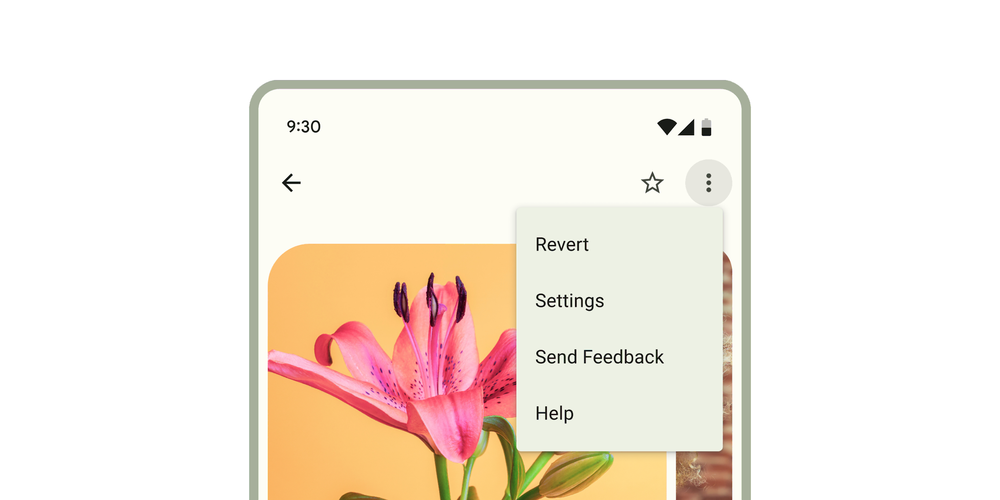

*   [Design article](https://m3.material.io/components/menus)
*   [API Documentation](#api)
*   [Source code](https://github.com/material-components/material-web/tree/main/menu)

## Interactive Demo



## Usage

When opened, menus position themselves to an anchor. Thus, either `anchor` or
`anchorElement` must be supplied to `md-menu` before opening. Additionally, a
shared parent of `position:relative` should be present around the menu and it's
anchor, because the default menu is positioned relative to the anchor element.

Menus also render menu items such as `md-menu-item` and handle keyboard
navigation between `md-menu-item`s as well as typeahead functionality.
Additionally, `md-menu` interacts with `md-menu-item`s to help you determine how
a menu was closed. Listen for and inspect the `close-menu` custom event's
`details` to determine what action and items closed the menu.

<div class="figure-wrapper">
  <style>
    main > .figure-wrapper {
      /* prevent scrolling bars on menu open */
      overflow: visible;
      /* unset page styles */
    }
  </style>
  <figure style="justify-content: center" aria-label="Two filled buttons next to each other. The first one says set with idref and the other says set with element ref. Interact with them to open their respective menus.">
    <span style="position: relative; margin-inline-end: 8px">
      <md-gb-button id="usage-anchor" color="filled">Set with idref</md-gb-button>
      <md-gb-menu id="usage-menu" anchor="usage-anchor">
        <md-gb-menu-item>
          Apple
        </md-gb-menu-item>
        <md-gb-menu-item>
          Banana
        </md-gb-menu-item>
        <md-gb-menu-item>
          Cucumber
        </md-gb-menu-item>
      </md-gb-menu>
    </span>
    <script type="module">
      const anchorEl = document.body.querySelector("#usage-anchor");
      const menuEl = document.body.querySelector("#usage-menu");
      anchorEl.addEventListener("click", () => {
        menuEl.open = !menuEl.open;
      });
    </script>
    <span style="position: relative">
      <md-gb-button id="usage-anchor-2" color="filled">Set with element ref</md-gb-button>
      <md-gb-menu id="usage-menu-2">
        <md-gb-menu-item>
          Apple
        </md-gb-menu-item>
        <md-gb-menu-item>
          Banana
        </md-gb-menu-item>
        <md-gb-menu-item>
          Cucumber
        </md-gb-menu-item>
      </md-gb-menu>
    </span>
    <script type="module">
      const anchorEl = document.body.querySelector("#usage-anchor-2");
      const menuEl = document.body.querySelector("#usage-menu-2");
      menuEl.anchorElement = anchorEl;
      anchorEl.addEventListener("click", () => {
        menuEl.open = !menuEl.open;
      });
    </script>
  </figure>
</div>

```html
<!-- Note the position: relative style -->
<span style="position: relative">
  <md-gb-button id="usage-anchor" color="filled">Set with idref</md-gb-button>
  <md-gb-menu id="usage-menu" anchor="usage-anchor">
    <md-gb-menu-item>
      Apple
    </md-gb-menu-item>
    <md-gb-menu-item>
      Banana
    </md-gb-menu-item>
    <md-gb-menu-item>
      Cucumber
    </md-gb-menu-item>
  </md-gb-menu>
</span>

<script type="module">
  // This example uses anchor as an ID reference
  const anchorEl = document.body.querySelector('#usage-anchor');
  const menuEl = document.body.querySelector('#usage-menu');

  anchorEl.addEventListener('click', () => { menuEl.open = !menuEl.open; });
</script>

<span style="position: relative">
  <md-gb-button id="usage-anchor-2" color="filled">Set with element ref</md-gb-button>
  <md-gb-menu id="usage-menu-2">
    <md-gb-menu-item>
      Apple
    </md-gb-menu-item>
    <md-gb-menu-item>
      Banana
    </md-gb-menu-item>
    <md-gb-menu-item>
      Cucumber
    </md-gb-menu-item>
  </md-gb-menu>
</span>

<script type="module">
  // This example uses MdMenu.prototype.anchorElement to set the anchor as an
  // HTMLElement reference.
  const anchorEl = document.body.querySelector('#usage-anchor-2');
  const menuEl = document.body.querySelector('#usage-menu-2');
  menuEl.anchorElement = anchorEl;

  anchorEl.addEventListener('click', () => { menuEl.open = !menuEl.open; });
</script>
```

### Popover-positioned menus

Internally menu uses `position: absolute` by default. Though there are cases
when the anchor and the node cannot share a common ancestor that is `position:
relative`, or sometimes, menu will render below another item due to limitations
with `position: absolute`.

Popover-positioned menus use the native
[Popover API](https://developer.mozilla.org/en-US/docs/Web/API/Popover_API)
to render above all other content. This may fix most issues where the default
menu positioning (`positioning="absolute"`) is not positioning as expected by
rendering into the
[top layer](https://developer.mozilla.org/en-US/docs/Glossary/Top_layer).

> Warning: Popover API support was added in Chrome 114 and Safari 17. At the
> time of writing, Firefox does not support the Popover API
> ([see latest browser compatibility](https://developer.mozilla.org/en-US/docs/Web/API/Popover_API#browser_compatibility)).
>
> For browsers that do not support the Popover API, `md-menu` will fall back to
> using [fixed-positioned menus](#fixed-positioned-menus).


<!-- Note the lack of position: relative parent. -->
<div style="margin: 16px;">
  <md-gb-button id="usage-popover-anchor" color="filled">Open popover menu</md-gb-button>
</div>

<!-- popover menus do not require a common ancestor with the anchor. -->
<md-gb-menu id="usage-popover" anchor="usage-popover-anchor">
  <md-gb-menu-item>
    Apple
  </md-gb-menu-item>
  <md-gb-menu-item>
    Banana
  </md-gb-menu-item>
  <md-gb-menu-item>
    Cucumber
  </md-gb-menu-item>
</md-gb-menu>

<script type="module">
  const anchorEl = document.body.querySelector('#usage-popover-anchor');
  const menuEl = document.body.querySelector('#usage-popover');

  anchorEl.addEventListener('click', () => { menuEl.open = !menuEl.open; });
</script>


### Fixed-positioned menus

This is the fallback implementation of
[popover-positioned menus](#popover-positioned-menus) and uses `position: fixed`
rather than the default `position: absolute` which calculates its position
relative to the window rather than the element.

> Note: Fixed menu positions are positioned relative to the window and not the
> document. This means that the menu will not scroll with the anchor as the page
> is scrolled.


<!-- Note the lack of position: relative parent. -->
<div style="margin: 16px;">
  <md-gb-button id="usage-fixed-anchor" color="filled">Open fixed menu</md-gb-button>
</div>

<!-- Fixed menus do not require a common ancestor with the anchor. -->
<md-gb-menu id="usage-fixed" anchor="usage-fixed-anchor">
  <md-gb-menu-item>
    Apple
  </md-gb-menu-item>
  <md-gb-menu-item>
    Banana
  </md-gb-menu-item>
  <md-gb-menu-item>
    Cucumber
  </md-gb-menu-item>
</md-gb-menu>

<script type="module">
  const anchorEl = document.body.querySelector('#usage-fixed-anchor');
  const menuEl = document.body.querySelector('#usage-fixed');

  anchorEl.addEventListener('click', () => { menuEl.open = !menuEl.open; });
</script>


### Document-positioned menus

When set to `positioning="document"`, `md-menu` will position itself relative to
the document as opposed to the element or the window from `"absolute"` and
`"fixed"` values respectively.

Document level positioning is useful for the following cases:

-   There are no ancestor elements that produce a `relative` positioning
    context.
    -   `position: relative`
    -   `position: absolute`
    -   `position: fixed`
    -   `transform: translate(x, y)`
    -   etc.
-   The menu is hoisted to the top of the DOM
    -   The last child of `<body>`
    -   [Top layer](https://developer.mozilla.org/en-US/docs/Glossary/Top_layer)

-   The same `md-menu` is being reused and the contents and anchors are being
    dynamically changed


<!-- Note the lack of position: relative parent. -->
<div style="margin: 16px;">
  <md-gb-button id="usage-document-anchor" color="filled">Open document menu</md-gb-button>
</div>

<!-- document menus do not require a common ancestor with the anchor. -->
<md-gb-menu id="usage-document" anchor="usage-document-anchor">
  <md-gb-menu-item>
    Apple
  </md-gb-menu-item>
  <md-gb-menu-item>
    Banana
  </md-gb-menu-item>
  <md-gb-menu-item>
    Cucumber
  </md-gb-menu-item>
</md-gb-menu>

<script type="module">
  const anchorEl = document.body.querySelector('#usage-document-anchor');
  const menuEl = document.body.querySelector('#usage-document');

  anchorEl.addEventListener('click', () => { menuEl.open = !menuEl.open; });
</script>


## Accessibility

By default Menu is set up to function as a `role="menu"` with children as
`role="menuitem"`. A common use case for this is the menu button example, where
you would need to add keyboard interactions to the button to open the menu
([see W3C example](https://www.w3.org/WAI/ARIA/apg/patterns/menu-button/examples/menu-button-actions/)).

Menu can also be adapted for other use cases.

The role of the `md-list` inside the menu can be set with the `type` attribute.
The role of each individual `md-menu-item` can also be set with the `type`
attribute. Anything else slotted into the menu that is not a list item in most
cases should be set to `role="none"`, and `md-divider` should have
`role="separator"` and `tabindex="-1"`.

```html
<!--
  A simplified example of an autocomplete component – missing javascript logic for interaction.
-->
<md-gb-text-field id="textfield" type="combobox" aria-controls="menu" aria-autocomplete="list" aria-expanded="true" aria-activedescendant="1" value="Ala">
</md-gb-text-field>
<md-gb-menu id="menu" anchor="textfield" role="listbox" aria-label="states" open>
  <md-gb-menu-item type="option" id="0">
    Alabama
  </md-gb-menu-item>
  <md-gb-divider role="separator" tabindex="-1"></md-gb-divider>
  <md-gb-menu-item type="option" id="1" selected aria-selected="true">
    Alabama
  </md-gb-menu-item>
</md-gb-menu>
```

## API


