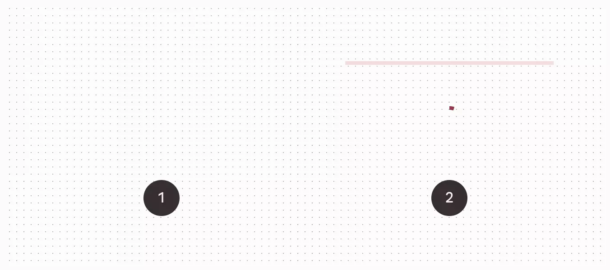

There are two types of progress indicators: linear and circular.



*   [Design article](https://m3.material.io/components/progress-indicators)

*   [API Documentation](#api)
*   [Source code](https://github.com/material-components/material-web/tree/main/progress)

## Types

1.  [Circular progress](#circular-progress)
1.  [Linear progress](#linear-progress)

## Interactive Demo



## Usage

Progress indicators may be determinate to show progress, or indeterminate for an
unspecified amount of progress.


<md-gb-progress value="0.75" circular></md-gb-progress>
<md-gb-progress circular></md-gb-progress>

<md-gb-progress></md-gb-progress>
<md-gb-progress value="0.5"></md-gb-progress>


### Four colors

Indeterminate progress indicators may cycle between four colors (primary,
primary container, tertiary, and tertiary container by default).


<md-gb-progress circular></md-gb-progress>
<md-gb-progress></md-gb-progress>


## Accessibility

Add an
[`aria-label`](https://developer.mozilla.org/en-US/docs/Web/Accessibility/ARIA/Attributes/aria-label)
attribute to progress indicators to give them a descriptive name.

```html
<md-gb-progress value="0.5" aria-label="Page refresh progress" circular></md-gb-progress>

<md-gb-progress value="0.5" aria-label="Download progress"></md-gb-progress>
```

## Circular progress

Circular progress indicators display progress by animating along an invisible
circular track in a clockwise direction.


<md-gb-progress circular></md-gb-progress>
<md-gb-progress value="0.6" circular></md-gb-progress>


## Linear progress

Linear progress indicators display progress by animating along the length of a
fixed, visible track.


<md-gb-progress></md-gb-progress>
<md-gb-progress value="0.6"></md-gb-progress>


### Buffer

Linear progress indicators may show a buffer to communicate both determinate and
indeterminate progress. The progress bar and track represent known progress
while the buffer dots represent unknown progress.


<md-gb-progress value="0.5"></md-gb-progress>


## API


