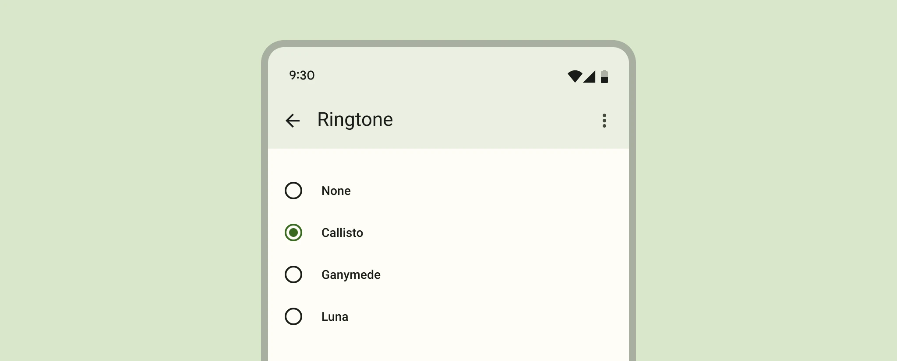

*   [Design article](https://m3.material.io/components/radio-button)
*   [API Documentation](#api)
*   [Source code](https://github.com/material-components/material-web/tree/main/radio)

## Interactive Demo



## Usage

Radios behave like
[`<input type="radio">`](https://developer.mozilla.org/en-US/docs/Web/HTML/Element/input/radio)
elements and form a group with the same `name` attribute. Only one radio can be
selected in a group.

Radios can be pre-selected by adding a `checked` attribute.

Add a `value` to identify which radio is selected in a form.

```html
<form>
  <md-gb-radio name="animals" value="cats"></md-gb-radio>
  <md-gb-radio name="animals" value="dogs"></md-gb-radio>
  <md-gb-radio name="animals" value="birds" checked></md-gb-radio>
</form>
```

### Label

Associate a label with a radio using the `<label>` element.

```html
<md-gb-radio id="cats-radio" name="animals" value="cats"></md-gb-radio>
<label for="cats-radio">Cats</label>

<md-gb-radio id="dogs-radio" name="animals" value="dogs"></md-gb-radio>
<label for="dogs-radio">Dogs</label>
```

> Note: do not wrap radios inside of a `<label>`, which stops screen readers
> from correctly announcing the number of radios in a group.

## Accessibility

Add an
[`aria-label`](https://developer.mozilla.org/en-US/docs/Web/Accessibility/ARIA/Attributes/aria-label)
attribute to radios without labels or radios whose labels need to be more
descriptive.

Place radios inside a
[`role="radiogroup"`](https://developer.mozilla.org/en-US/docs/Web/Accessibility/ARIA/Roles/radiogroup_role).
Radio groups must display a label, either with `aria-label` or
`aria-labelledby`.

```html
<div role="radiogroup" aria-labelledby="group-title">
  <h3 id="group-title">Starting position</h3>
  <div>
    <md-gb-radio id="first-radio" name="group" value="1" aria-label="First"></md-gb-radio>
    <label for="first-radio">1st</label>
  </div>
  <div>
    <md-gb-radio id="second-radio" name="group" value="2" aria-label="Second"></md-gb-radio>
    <label for="second-radio">2nd</label>
  </div>
</div>
```

> Note: radios are not automatically labelled by `<label>` elements and always
> need an `aria-label`. See b/294081528.

## API


