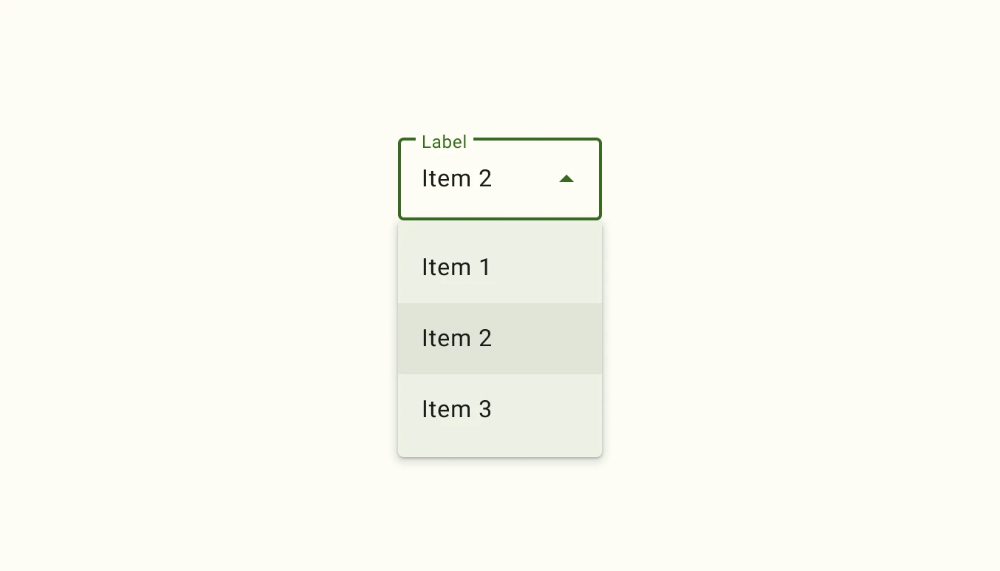

*   Design article (*coming soon*)
*   [API Documentation](#api)
*   [Source code](https://github.com/material-components/material-web/tree/main/select)

## Usage

Select (also referred to as a dropdown menu) allows choosing a value from a
fixed list of available options. It is analogous to the native HTML
[`<select>` element](https://developer.mozilla.org/en-US/docs/Web/HTML/Element/select).

<div class="figure-wrapper">
  <style>
    main > .figure-wrapper {
      /* prevent scrolling bars on dropdown menu open */
      overflow: visible;
      /* unset page styles */
    }
  </style>
  <figure style="justify-content: center; gap: 8px" title="Example usage of an outlined dropdown menu and a filled dropdown menu." aria-label="An outlined dropdown menu filled with Apple, and a filled dropdown menu.">
    <md-gb-select variant="outlined" aria-label="Fruit">
      <md-gb-select-option aria-label="blank"></md-gb-select-option>
      <md-gb-select-option selected value="apple">
        Apple
      </md-gb-select-option>
      <md-gb-select-option value="apricot">
        Apricot
      </md-gb-select-option>
    </md-gb-select>
    <md-gb-select aria-label="Fruit">
      <md-gb-select-option aria-label="blank"></md-gb-select-option>
      <md-gb-select-option value="apple">
        Apple
      </md-gb-select-option>
      <md-gb-select-option value="apricot">
        Apricot
      </md-gb-select-option>
    </md-gb-select>
  </figure>
</div>

```html
<md-gb-select variant="outlined" aria-label="Fruit">
  <md-gb-select-option aria-label="blank"></md-gb-select-option>
  <md-gb-select-option selected value="apple">
    Apple
  </md-gb-select-option>
  <md-gb-select-option value="apricot">
    Apricot
  </md-gb-select-option>
</md-gb-select>

<md-gb-select aria-label="Fruit">
  <md-gb-select-option aria-label="blank"></md-gb-select-option>
  <md-gb-select-option value="apple">
    Apple
  </md-gb-select-option>
  <md-gb-select-option value="apricot">
    Apricot
  </md-gb-select-option>
</md-gb-select>
```

### Required select

Indicate that a selection is mandatory by adding the `required` attribute.

```html
<md-gb-select required aria-label="Fruit">
  <md-gb-select-option value="one">
    One
  </md-gb-select-option>
  <md-gb-select-option value="two">
    Two
  </md-gb-select-option>
</md-gb-select>
```

<!--
## Accessibility

*Insert a 1-2 sentence description of a common accessibility scenario, followed
by a code snippet. Do not include a rendered image for accessibility examples.*

```html
<component-name aria-label="Example">
```

*Repeat with additional examples as needed to explain how to make the component
accessible.* -->

## API


