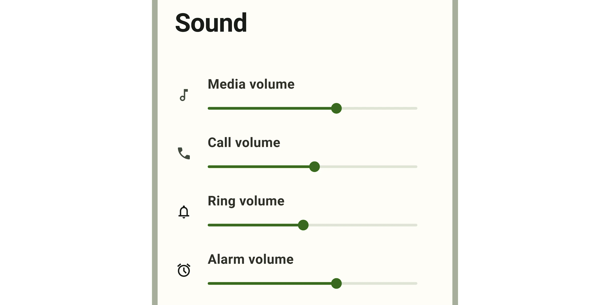

[Sliders](https://m3.material.io/components/sliders) allow users to
view and select a value (or range) along a track. They're ideal for adjusting
settings such as volume and brightness, or for applying image filters.

Sliders can use icons or labels to represent a numeric or relative scale.



*   [Design article](https://m3.material.io/components/sliders)
*   [API Documentation](#api)
*   [Source code](https://github.com/material-components/material-web/tree/main/slider)

## Interactive Demo



## Usage

Sliders may be continuous or discrete, and may also represent a range.

```html
<md-gb-slider></md-gb-slider>
<md-gb-slider ticks value="50"></md-gb-slider>
<md-gb-slider range value-start="25" value-end="75"></md-gb-slider>
```

### Continuous

Allows users to select a value along a subjective range.

```html
<md-gb-slider min="0" max="100" value="50"></md-gb-slider>
```

### Discrete

Allows users to select a specific value from a predetermined range. Tick marks
may be used to indicate available values.

```html
<md-gb-slider step="5" ticks min="0" max="20"></md-gb-slider>
```

### Range

A range slider has two handles, and indicates a minimum and maximum value in a
range.

```html
<md-gb-slider range value-start="25" value-end="50"></md-gb-slider>
```

### Value label

A value label displays the specific value that corresponds with the handle's
placement.

The label appears when the handle is selected. For range sliders, labels appear
when either handle is selected.

```html
<md-gb-slider labeled></md-gb-slider>
```

## API


