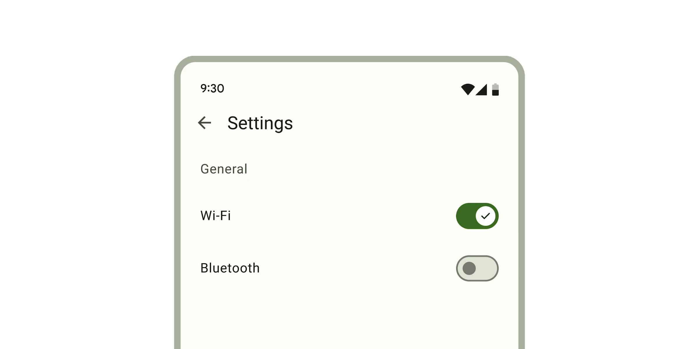

*   [Design article](https://m3.material.io/components/switch)
*   [API Documentation](#api)
*   [Source code](https://github.com/material-components/material-web/tree/main/switch)

## Interactive Demo



## Usage

Switches are similar to checkboxes, and can be unselected or selected.

```html
<md-gb-switch></md-gb-switch>
<md-gb-switch selected></md-gb-switch>
```

### Icons

Icons can be used to visually emphasize the switch's selected state. Switches
can choose to display both icons or only selected icons.

```html
<md-gb-switch icons></md-gb-switch>
<md-gb-switch icons selected></md-gb-switch>

<md-gb-switch icons show-only-selected-icon></md-gb-switch>
<md-gb-switch icons show-only-selected-icon selected></md-gb-switch>
```

### Label

Associate a label with a switch using the `<label>` element.

```html
<label>
  Wi-Fi
  <md-gb-switch selected></md-gb-switch>
</label>

<label for="switch">Bluetooth</label>
<md-gb-switch id="switch"></md-gb-switch>
```

## Accessibility

Add an
[`aria-label`](https://developer.mozilla.org/en-US/docs/Web/Accessibility/ARIA/Attributes/aria-label)
attribute to switches without labels or switches whose labels need to be more
descriptive.

```html
<md-gb-switch aria-label="Lights"></md-gb-switch>

<label>
  All
  <md-gb-switch aria-label="All notifications"></md-gb-switch>
</label>
```

> Note: switches are not automatically labelled by `<label>` elements and always
> need an `aria-label`. See b/294081528.

## API


