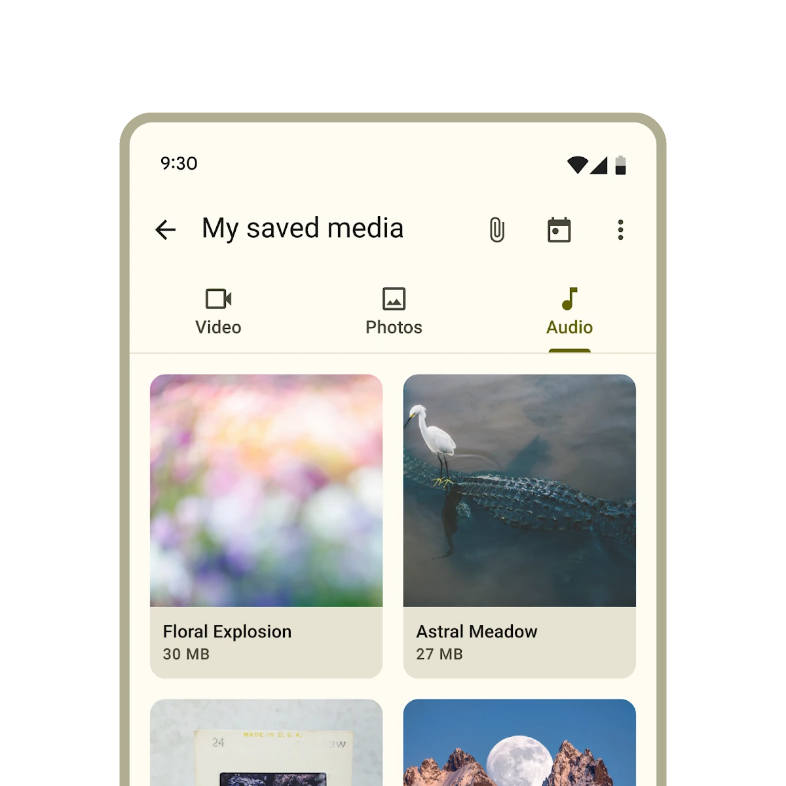

*   [Design article](https://m3.material.io/components/tabs)
*   [API Documentation](#api)
*   [Source code](https://github.com/material-components/material-web/tree/main/tabs)

## Types

1.  [Primary tabs](#primary-tabs)
1.  [Secondary tabs](#secondary-tabs)

## Interactive Demo



## Usage

Tabs contain multiple primary or secondary tab children. Use the same type of
tab in a tab bar.

```html
<md-gb-tabs>
  <md-gb-tab><span slot="label">Video</span></md-gb-tab>
  <md-gb-tab><span slot="label">Photos</span></md-gb-tab>
  <md-gb-tab><span slot="label">Audio</span></md-gb-tab>
</md-gb-tabs>

<md-gb-tabs variant="secondary">
  <md-gb-tab><span slot="label">Birds</span></md-gb-tab>
  <md-gb-tab><span slot="label">Cats</span></md-gb-tab>
  <md-gb-tab><span slot="label">Dogs</span></md-gb-tab>
</md-gb-tabs>
```

### Selection

Add an `active` attribute to change which tab is selected.

```html
<md-gb-tabs>
  <md-gb-tab><span slot="label">Video</span></md-gb-tab>
  <md-gb-tab><span slot="label">Photos</span></md-gb-tab>
  <md-gb-tab><span slot="label">Audio</span></md-gb-tab>
</md-gb-tabs>
```

To observe changes to tab selections, add an event listener to `<md-gb-tabs>`,
listening for the `change` event.

```ts
tabs.addEventListener('change', (event: Event) => {
  if (event.target.activeTabIndex === 2) {
    // ... perform logic only if index of selected item is 2.
  }
});
```

### Icons

Tabs may optionally show an icon.

Icons communicate the type of content within a tab. Icons should be simple and
recognizable.

```html
<md-gb-tabs>
  <md-gb-tab><md-gb-icon>piano</md-gb-icon>
    <span slot="label">Keyboard</span></md-gb-tab>
  <md-gb-tab><md-gb-icon>tune</md-gb-icon>
    <span slot="label">Guitar</span></md-gb-tab>
</md-gb-tabs>
```

Tabs may optionally show icons without a label.

```html
<md-gb-tabs>
  <md-gb-tab><md-gb-icon>piano</md-gb-icon>

  </md-gb-tab>
  <md-gb-tab><md-gb-icon>tune</md-gb-icon>

  </md-gb-tab>
</md-gb-tabs>
```

## Primary tabs

Primary tabs are placed at the top of the content pane under a top app bar. They
display the main content destinations.

```html
<md-gb-tabs>
  <md-gb-tab><md-gb-icon>piano</md-gb-icon>
    <span slot="label">Keyboard</span></md-gb-tab>
  <md-gb-tab><md-gb-icon>tune</md-gb-icon>
    <span slot="label">Guitar</span></md-gb-tab>
</md-gb-tabs>
```

### Inline icons

Primary tabs can show their icons inline, like secondary tabs.

```html
<md-gb-tabs>
  <md-gb-tab><md-gb-icon>piano</md-gb-icon>
    <span slot="label">Keyboard</span></md-gb-tab>
  <md-gb-tab><md-gb-icon>tune</md-gb-icon>
    <span slot="label">Guitar</span></md-gb-tab>
</md-gb-tabs>
```

## Secondary tabs

Secondary tabs are used within a content area to further separate related
content and establish hierarchy.

```html
<md-gb-tabs variant="secondary">
  <md-gb-tab><md-gb-icon>flight</md-gb-icon>
    <span slot="label">Travel</span></md-gb-tab>
  <md-gb-tab><md-gb-icon>hotel</md-gb-icon>
    <span slot="label">Hotel</span></md-gb-tab>
  <md-gb-tab><md-gb-icon>hiking</md-gb-icon>
    <span slot="label">Activities</span></md-gb-tab>
</md-gb-tabs>
```

## Accessibility

Add an
[`aria-label`](https://developer.mozilla.org/en-US/docs/Web/Accessibility/ARIA/Attributes/aria-label)
attribute to `<md-gb-tabs>` and any individual tab whose label needs to be more
descriptive, such as icon-only tabs.

```html
<md-gb-tabs aria-label="Content to view">
  <md-gb-tab aria-label="Photos"><md-gb-icon>photo</md-gb-icon>

  </md-gb-tab>
  <md-gb-tab aria-label="Videos"><md-gb-icon>videocam</md-gb-icon>

  </md-gb-tab>
  <md-gb-tab aria-label="Music"><md-gb-icon>audiotrack</md-gb-icon>

  </md-gb-tab>
</md-gb-tabs>
```

### Tab panels

Every tab must reference a
[`role="tabpanel"`](https://developer.mozilla.org/en-US/docs/Web/Accessibility/ARIA/Roles/tabpanel_role)
element with `aria-controls`. Tab panels must be labelled with `aria-label` or
`aria-labelledby`.

It's common to reference the panel's tab with `aria-labelledby`.

```html
<md-gb-tabs aria-label="Content to view">
  <md-gb-tab id="photos-tab" aria-controls="photos-panel"><span slot="label">Photos</span></md-gb-tab>
  <md-gb-tab id="videos-tab" aria-controls="videos-panel"><span slot="label">Videos</span></md-gb-tab>
  <md-gb-tab id="music-tab" aria-controls="music-panel"><span slot="label">Music</span></md-gb-tab>
</md-gb-tabs>

<div id="photos-panel" role="tabpanel" aria-labelledby="photos-tab">
  ...
</div>
<div id="videos-panel" role="tabpanel" aria-labelledby="videos-tab" hidden>
  ...
</div>
<div id="music-panel" role="tabpanel" aria-labelledby="music-tab" hidden>
  ...
</div>
```

## API


