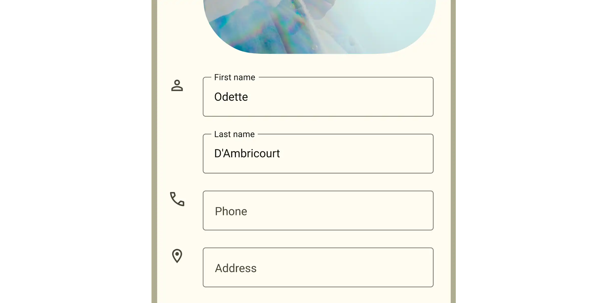

*   [Design article](https://m3.material.io/components/text-fields)
*   [API Documentation](#api)
*   [Source code](https://github.com/material-components/material-web/tree/main/textfield)

## Types

1.  [Filled text field](#filled-text-field)
1.  [Outlined text field](#outlined-text-field)

## Interactive Demo



## Usage

Text fields behave like
[`<input>`](https://developer.mozilla.org/en-US/docs/Web/HTML/Element/input)
elements. They provide a container with labels for user input.

<div class="figure-wrapper">
  <figure aria-label="A filled textfield next to an outlined textfield. Both have a value of Value prefilled" style="padding-block: 16px; gap: 16px">
    <md-gb-text-field label="Label" value="Value"></md-gb-text-field>
    <md-gb-text-field label="Label" value="Value" variant="outlined"></md-gb-text-field>
  </figure>
</div>

```html
<md-gb-text-field label="Label" value="Value">
</md-gb-text-field>

<md-gb-text-field label="Label" value="Value" variant="outlined">
</md-gb-text-field>
```

### Input type

A text field's `type` attribute changes how the text field works, such as
displaying a different keyboard or providing default validation.

-   [`type="text"`](https://developer.mozilla.org/en-US/docs/Web/HTML/Element/input/text)
    (default)
-   [`type="email"`](https://developer.mozilla.org/en-US/docs/Web/HTML/Element/input/email)

-   [`type="number"`](https://developer.mozilla.org/en-US/docs/Web/HTML/Element/input/number)

-   [`type="password"`](https://developer.mozilla.org/en-US/docs/Web/HTML/Element/input/password)

-   [`type="search"`](https://developer.mozilla.org/en-US/docs/Web/HTML/Element/input/search)

-   [`type="tel"`](https://developer.mozilla.org/en-US/docs/Web/HTML/Element/input/tel)

-   [`type="url"`](https://developer.mozilla.org/en-US/docs/Web/HTML/Element/input/url)

-   [`type="textarea"`](https://developer.mozilla.org/en-US/docs/Web/HTML/Element/textarea)

<div class="figure-wrapper">
  <figure aria-label="Two filled textfields next to each other. The first has a label of Username and the outlined one has a label of Password" style="padding-block: 16px; gap: 16px">
    <md-gb-text-field label="Username" type="email"></md-gb-text-field>
    <md-gb-text-field label="Password" type="password"></md-gb-text-field>
  </figure>
</div>

```html
<md-gb-text-field label="Username" type="email">
</md-gb-text-field>

<md-gb-text-field label="Password" type="password">
</md-gb-text-field>
```

> Tip: use the
> [`inputmode`](https://developer.mozilla.org/en-US/docs/Web/HTML/Global_attributes/inputmode)
> attribute for more control over the displayed keyboard.

### Labels

Text fields should label their value with a floating `label`, a `placeholder`,
or an external label. Labels help the user understand what value to input.

<div class="figure-wrapper">
  <figure aria-label="Three outlined textfields next to each other. the first has a label of Favorite food, the second one a placeholder of email@domain.com and there is a label that says First name and an empty outlined textfield next to it" style="padding-block: 16px; gap: 16px">
    <md-gb-text-field label="Favorite food" variant="outlined"></md-gb-text-field>
    <md-gb-text-field placeholder="email@domain.com" variant="outlined"></md-gb-text-field>
    <div>First name</div>
    <md-gb-text-field aria-label="First name" variant="outlined"></md-gb-text-field>
  </figure>
</div>

```html
<md-gb-text-field label="Favorite food" variant="outlined">
</md-gb-text-field>

<md-gb-text-field placeholder="email@domain.com" variant="outlined">
</md-gb-text-field>

<div>First name</div>
<md-gb-text-field aria-label="First name" variant="outlined">
</md-gb-text-field>
```

> Note: text fields do not currently support `aria-labelledby`. External labels
> must provide an `aria-label`. See b/276484803.

### Textarea

Multi-line text fields behave like
[`<textarea>`](https://developer.mozilla.org/en-US/docs/Web/HTML/Element/textarea)
elements.

Textareas can specify the initial number of `rows`. Use CSS `width`, `height`,
and `resize` to control the resize behavior of a textarea.

<div class="figure-wrapper textarea">
  <figure aria-label="A filled textarea that is vertically larger and has a label that says Vertical resize" style="padding-block: 16px; gap: 16px">
  <style>
    .figure-wrapper.textarea md-gb-text-field {
      resize: vertical;
    }
  </style>
  <md-gb-text-field type="textarea" label="Vertical resize" rows="3"></md-gb-text-field>
  </figure>
</div>

```html
<style>
  md-filled-text-field {
    resize: vertical;
  }
</style>
<md-gb-text-field type="textarea" label="Vertical resize" rows="3">
</md-gb-text-field>
```

### Icons

Text fields may display optional icons. Use icons to describe the input method
(such as a search icon), provide additional functionality (such as a clear
icon), or to express errors.

<div class="figure-wrapper">
  <figure aria-label="Three outlined textfields next to each other the first has a search icon at the start the label Search Messages, the second a label that says Password and an eye icon toggle button at the end, and a red, visually errored outlined textfield with the label Username with an exclamation icon at the end and helper error text under the field that says Username not available" style="padding-block: 16px; gap: 16px">
    <md-gb-text-field placeholder="Search for messages" has-leading-icon variant="outlined">
      <md-gb-icon slot="leading-icon">search</md-gb-icon>
    </md-gb-text-field>
    <md-gb-text-field label="Password" type="password" has-trailing-icon variant="outlined">
      <md-gb-icon-button slot="trailing-icon" color="standard" aria-label="Visibility">
        <md-gb-icon>visibility</md-gb-icon>
      </md-gb-icon-button>
    </md-gb-text-field>
    <md-gb-text-field label="Username" error error-text="Username not available" has-trailing-icon variant="outlined">
      <md-gb-icon slot="trailing-icon">error</md-gb-icon>
    </md-gb-text-field>
  </figure>
</div>

```html
<md-gb-text-field placeholder="Search for messages" has-leading-icon variant="outlined">
  <md-gb-icon slot="leading-icon">search</md-gb-icon>
</md-gb-text-field>

<md-gb-text-field label="Password" type="password" has-trailing-icon variant="outlined">
  <md-gb-icon-button slot="trailing-icon" color="standard" aria-label="Visibility">
    <md-gb-icon>visibility</md-gb-icon>

  </md-gb-icon-button>
</md-gb-text-field>

<md-gb-text-field label="Username" error error-text="Username not available" has-trailing-icon variant="outlined">
  <md-gb-icon slot="trailing-icon">error</md-gb-icon>
</md-gb-text-field>
```

### Prefix and suffix

Add `prefix-text` and `suffix-text` attributes to text fields to display
additional context for the value.

<div class="figure-wrapper textarea">
  <figure aria-label="An outlined textfield with a floating label that says Dollar amount, a prefix dollar sign, the number zero as a value and a suffix of decimal zero zero at the end of the field" style="padding-block: 16px; gap: 16px">
    <md-gb-text-field label="Dollar amount" type="number" value="0" prefix-text="$" suffix-text=".00" variant="outlined"></md-gb-text-field>
  </figure>
</div>

```html
<md-gb-text-field label="Dollar amount" type="number" value="0" prefix-text="$" suffix-text=".00" variant="outlined">
</md-gb-text-field>
```

### Supporting text

Supporting text conveys additional information about the input field, such as
how it will be used. Supporting text can be replaced with error text when
[validating](#validation).

<div class="figure-wrapper">
  <figure aria-label="Two filled fields next to each other. The first has a label that says comments and supporting text under the field that says Provide comments for the issue. The second field has a label of Name with an asterisk and supporting text under the field that has an asterisk followed by the word required" style="padding-block: 16px; gap: 16px">
    <md-gb-text-field label="Comments" supporting-text="Provide comments for the issue"></md-gb-text-field>
    <md-gb-text-field label="Name" required supporting-text="*required" error-text="Please fill out this field"></md-gb-text-field>
  </figure>
</div>

```html
<md-gb-text-field label="Comments" supporting-text="Provide comments for the issue">
</md-gb-text-field>

<md-gb-text-field label="Name" required supporting-text="*required" error-text="Please fill out this field">
</md-gb-text-field>
```

### Character counter

Text fields with a `maxlength` attribute will display a character counter.

<div class="figure-wrapper">
  <figure aria-label="An outlined textfield with a floating label that says Title and a filled value that says Short and the text 5 / 10 under the field at the end" style="padding-block: 16px; gap: 16px">
    <md-gb-text-field label="Title" value="Short" maxlength="10" variant="outlined"></md-gb-text-field>
  </figure>
</div>

```html
<md-gb-text-field label="Title" value="Short" maxlength="10" variant="outlined">
</md-gb-text-field>
```

### Validation

Text fields that validate can use
[constraint validation](#constraint-validation) or
[manual validation](#manual-validation).

#### Constraint validation

Text fields may validate using the browser's
[constraint validation](https://developer.mozilla.org/en-US/docs/Web/HTML/Constraint_validation)
API. Each [input type](#input-type) above links to an article that describes how
to validate it.

Text fields in a `<form>` will validate on submission, or by calling
`textField.reportValidity()`.

```html
<form>
  <md-gb-text-field name="name" label="Name" required>
  </md-gb-text-field>
  <md-gb-text-field name="email" label="Email" pattern="[\w\d-]+" suffix-text="@gmail.com">
  </md-gb-text-field>
</form>
```

Use the following properties and methods to check and report validation errors.

-   `validity` is the text field's current
    [`ValidityState`](https://developer.mozilla.org/en-US/docs/Web/API/ValidityState).
-   [`setCustomValidity()`](https://developer.mozilla.org/en-US/docs/Web/API/HTMLInputElement/setCustomValidity)
    sets a custom error message.
-   [`checkValidity()`](https://developer.mozilla.org/en-US/docs/Web/API/HTMLInputElement/checkValidity)
    dispatches an
    [`invalid` event](https://developer.mozilla.org/en-US/docs/Web/API/HTMLInputElement/invalid_event).
-   [`reportValidity()`](https://developer.mozilla.org/en-US/docs/Web/API/HTMLInputElement/reportValidity)
    dispatches an
    [`invalid` event](https://developer.mozilla.org/en-US/docs/Web/API/HTMLInputElement/invalid_event)
    and displays the error in the text field's supporting text.

#### Manual validation

Alternatively, text fields can manually control their error state and error
message. Use manual validation if the text fields are driven by application
state logic.

```html
<md-gb-text-field label="Username" value="jdoe" error error-text="Username is not available" variant="outlined">
</md-gb-text-field>
```

> Tip: Prefer [constraint validation](#constraint-validation) when possible for
> more platform features, such as `<form>` validation and listening to `invalid`
> events.

## Accessibility

Add an
[`aria-label`](https://developer.mozilla.org/en-US/docs/Web/Accessibility/ARIA/Attributes/aria-label)
attribute to text fields with external labels or text fields whose labels need
to be more descriptive.

```html
<div>Username</div>
<md-gb-text-field aria-label="Username"></md-gb-text-field>

<md-gb-text-field label="First" aria-label="First name"></md-gb-text-field>
```

## Filled text field

Filled and outlined text fields are functionally identical. See
[choosing a text field](https://m3.material.io/components/text-fields/guidelines#83956188-4d8f-4c11-9389-aaba30b10214)
for guidance on which one to use.

```html
<md-gb-text-field label="Filled" value="Value"></md-gb-text-field>
```

## Outlined text field

Filled and outlined text fields are functionally identical. See
[choosing a text field](https://m3.material.io/components/text-fields/guidelines#83956188-4d8f-4c11-9389-aaba30b10214)
for guidance on which one to use.

```html
<md-gb-text-field label="Outlined" value="Value" variant="outlined"></md-gb-text-field>
```

## API


